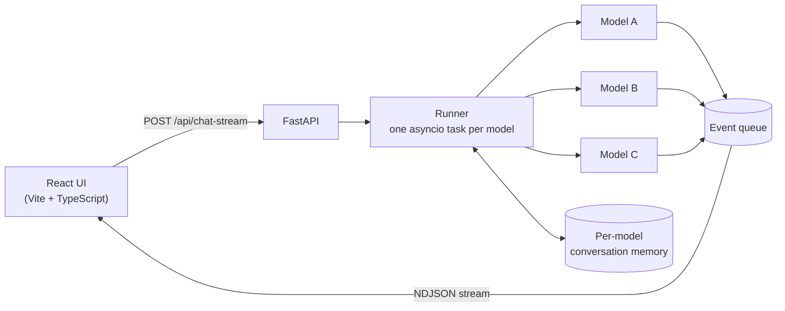
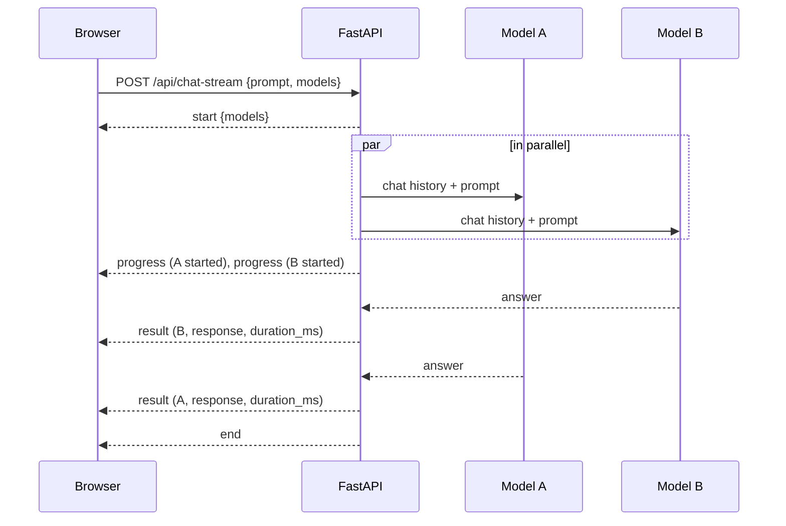

# How it works

When you click **Run**, the frontend sends the prompt and the selected models to `POST /api/chat-stream`. The backend starts one asyncio task per model. Each task adds the prompt to that model's history, calls the model with the whole history, and puts the result on a shared queue. The endpoint reads from that queue and writes each event to the response as one line of JSON, which is how the page can show an answer the moment its model is done.



Here is one request with two models. Model B answers first, so its result reaches the browser first:



Conversation history lives in memory in the backend process (`services/state.py`). Everyone using the same backend shares it, and it's gone when the server restarts.

## Where things are

```
Multi-LLM-Runner/
├── backend/
│   └── app/
│       ├── main.py                    FastAPI app and CORS
│       ├── api.py                     HTTP routes
│       ├── core/settings.py           environment settings
│       ├── models/llm_provider.py     OpenRouter and Kong clients, retries, routing
│       ├── models/question_objects.py benchmark loader and LLM-judge schema
│       └── services/
│           ├── runner.py              runs the models and streams the events
│           └── state.py               per-model conversation memory
└── frontend/
    └── src/App.tsx                    model picker, answer columns, Markdown and maths
```
