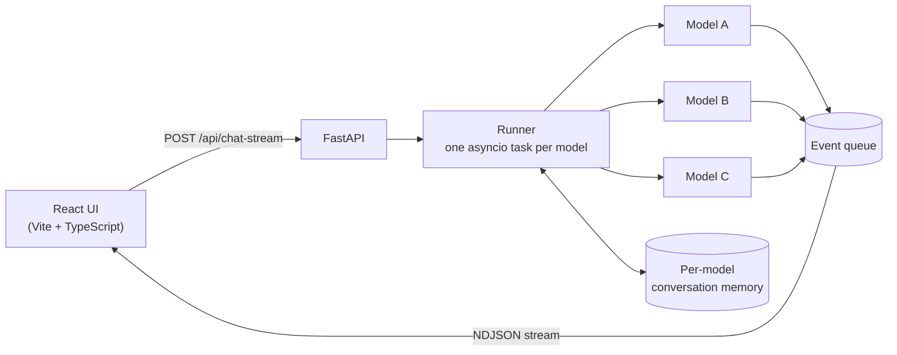
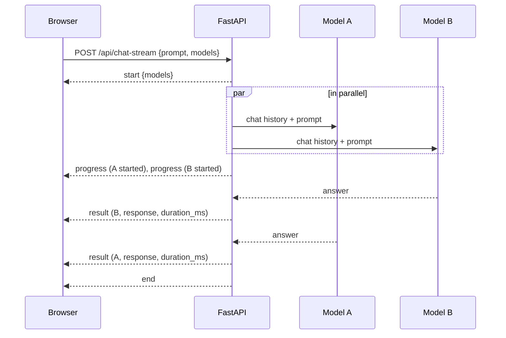

# How it works
{: .no_toc }

1. TOC
{:toc}

---

## Architecture

The React interface sends a prompt and a list of models to the FastAPI backend. The runner starts one `asyncio` task per model, each with that model's conversation history, and pushes every event onto a queue that streams back to the browser as newline-delimited JSON.



## Request lifecycle

Each prompt follows the same lifecycle. Results arrive in the order the models finish, not the order they were selected.



## Project structure

```
Multi-LLM-Runner/
├── backend/
│   └── app/
│       ├── main.py                    FastAPI app and CORS
│       ├── api.py                     HTTP routes
│       ├── core/settings.py           environment settings
│       ├── models/llm_provider.py     OpenRouter and Kong clients, retries, routing
│       ├── models/question_objects.py benchmark loader and LLM-judge schema
│       └── services/
│           ├── runner.py              concurrent fan-out and event streaming
│           └── state.py               per-model conversation memory
└── frontend/
    └── src/App.tsx                    model picker, streaming columns, Markdown and maths
```
